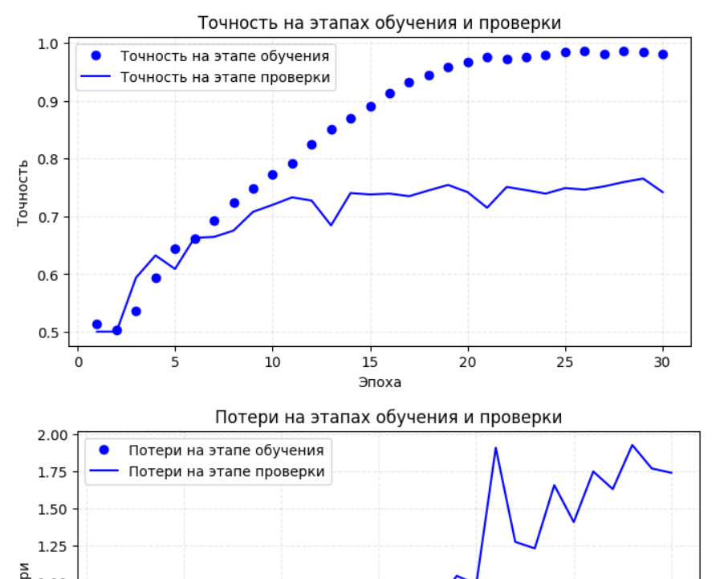
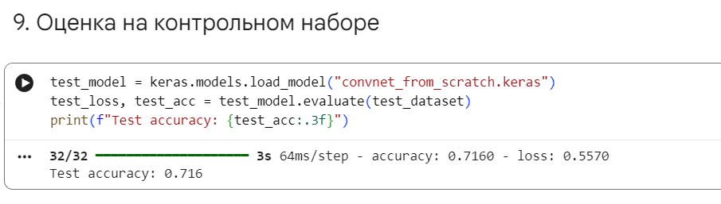

# Разработка классификатора

Заметим, что реализация кода формирующего структуру папок в информационных материалах отличается от сгенерированного нами. Код из инфо-материалов выглядит так:

```py
import os, shutil, pathlib

original_dir = pathlib.Path("train")
new_base_dir = pathlib.Path("cats_vs_dogs_small")

def make_subset(subset_name, start_index, end_index):
  for category in ("cat", "dog"):
    dir = new_base_dir / subset_name / category
    os.makedirs(dir)
    fnames = [f"{category}.{i}.jpg"
      for i in range(start_index, end_index)]
    for fname in fnames:
      shutil.copyfile(src=original_dir / fname,
                      dst=dir / fname)

make_subset("train", start_index=0, end_index=1000)
make_subset("validation", start_index=1000, end_index=1500)
make_subset("test", start_index=1500, end_index=2500)
```

Результат однако, такой же и коде приведённом в файле "README.md" - создаются папки с именами "train", "test" и "validation", в каждой из которых есть подпапки "dog" и "cat".

Ключевая часть кода - определение архитектуры нейронной сети. Код из учебных материалов выглядит следующим образом:

```py
# Создание небольшой сверточной нейронной сети для классификации изображений кошек и собак

from tensorflow import keras
from tensorflow.keras import layers

inputs = keras.Input(shape=(180, 180, 3))

x = layers.Rescaling(1./255)(inputs)
x = layers.Conv2D(filters=32, kernel_size=3, activation="relu")(x)
x = layers.MaxPooling2D(pool_size=2)(x)

x = layers.Conv2D(filters=64, kernel_size=3, activation="relu")(x)
x = layers.MaxPooling2D(pool_size=2)(x)

x = layers.Conv2D(filters=128, kernel_size=3, activation="relu")(x)
x = layers.MaxPooling2D(pool_size=2)(x)

x = layers.Conv2D(filters=256, kernel_size=3, activation="relu")(x)
x = layers.MaxPooling2D(pool_size=2)(x)

x = layers.Conv2D(filters=256, kernel_size=3, activation="relu")(x)
x = layers.Flatten()(x)

outputs = layers.Dense(1, activation="sigmoid")(x)

model = keras.Model(inputs=inputs, outputs=outputs)
model.summary()
```

Этот код задает классическую сверточную нейронную сеть (CNN) с использованием функционального API библиотеки Keras (TensorFlow). Модель предназначена для задачи бинарной классификации цветных изображений.

При создании входного узела модели указывается, что сеть ожидает на вход цветные изображения высотой 180 пикселей, шириной 180 пикселей и с 3 цветовыми каналами (RGB). Стоит заметить, что реальные изображения имеют другую размерность - 500x375. Сама по себе представленная модель не умеет автоматически менять геометрический размер исходной картинки — слой Rescaling(1./255) меняет только числовые значения пикселей (яркость от 0 до 1), но не их количество. Модель ожидает на входе строго форму тензора (180, 180, 3).

Масштабировать можно было бы в самой модели:

```py
# None означает, что модель готова принять картинку любой высоты и ширины
inputs = keras.Input(shape=(None, None, 3))

# Слой изменяет геометрию до 180x180 пикселей
x = layers.Resizing(180, 180, crop_to_aspect_ratio=True)(inputs)

# Далее слой нормализации значений пикселей
x = layers.Rescaling(1./255)(x)
```

Или масштабирование может быть выполнено при считывании изображений для обработки:

```py
train_dataset = image_dataset_from_directory(
    new_base_dir / "train",
    image_size=(180, 180),
    batch_size=32)
validation_dataset = image_dataset_from_directory(
    new_base_dir / "validation",
    image_size=(180, 180)
    batch_size=32)
test_dataset = image_dataset_from_directory(
    new_base_dir / "test",
    image_size=(180, 180),
    batch_size=32)
```

В коде описания архитектуры описывается блок из пяти сверточных слоев и четырех слоев подвыборки:

- `layers.Conv2D(filters, kernel_size=3, activation="relu")`: **сверточный слой** с ядром размера 3 на 3 пикселя и функцией активации ReLU. По мере углубления в сеть количество фильтров постепенно увеличивается: 32 -> 64 -> 128 -> 256 -> 256.
    - Начальные слои с малым числом фильтров (32, 64) находят простые паттерны: границы, линии, цветовые переходы
    - Более глубокие слои (128, 256) выявляют сложные текстуры и части объектов
- `layers.MaxPooling2D(pool_size=2)`: **слой пулинга** уменьшает пространственные размеры карты признаков в два раза по высоте и ширине (берется максимум из окна 2 на 2). Это уменьшает количество вычислений и делает сеть более устойчивой к небольшим сдвигам и искажениям объектов на изображении

Следующий код осуществляет выпрямление и классификацию:

```py
x = layers.Flatten()(x)
outputs = layers.Dense(1, activation="sigmoid")(x)
```

- `Flatten()`: преобразует многомерный массив карт признаков в одномерный вектор, чтобы его можно было передать в полносвязный слой
- `Dense(1, activation="sigmoid")`: выходной слой с одним нейроном и сигмоидной функцией активации. Сигмоида сжимает выходное значение в диапазон (0, 1), интерпретируемый как вероятность принадлежности изображения к целевому классу

Сборка модели:

```py
model = keras.Model(inputs=inputs, outputs=outputs)
model.summary()
```

Настройка модели для обучения:

```py
model.compile(loss="binary_crossentropy",
              optimizer="rmsprop",
              metrics=["accuracy"])
```

## История пути к успеху

...

## Финальные результаты




